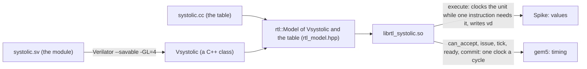

# rtl

A unit here is real hardware: a SystemVerilog module. Verilator turns it into a
C++ class, and one shared wrapper, `rtl_model.hpp` (`rtl::Model<V, T>`), turns
that class into a vcix model. Spike and gem5 both load the result, and both
clock the same Verilated unit: Spike for the values, gem5 for the timing.



You write two files: the module and a small table. You write no `execute`,
no `issue` and no timing code. The wrapper is a `cp::Model` of the base layer
(`include/vcix_cp_base.hpp`), not a `cp::Coprocessor`: the unit's own clock is
its timing. The rules every model follows (call order, `Unknown` and `ready`,
squash) are in the [root README](../../README.md).

## The three libraries

- `librtl_systolic.so`: `systolic/systolic.sv` built with `L=4`, the tpu
  example's systolic array on int8. Input push, weight push, pop.
- `librtl_systolic_nowait.so`: the same module with `WEIGHT_WAITS=0`. A weight
  push does not wait for older inputs. It breaks [rule 2](#the-two-rules) on
  purpose, and the checks catch it.
- `librtl_systolic_badtag.so`: the same module with `BAD_TAG=1`. Every
  `out_tag` is one off. Both faces check the tag and stop
  ([the messages](#messages-that-end-a-run)).

The array is built three times from one source with different `-G`
parameters (`CMakeLists.txt:43-51`).

### Which instruction is which

The table matches the instruction bits under a mask. `FORM = 0xFE00707F`
keeps bits 31:25, 14:12 and 6:0. The register fields (`vs2`, `rs1`, `rd`)
are left free. The three instructions of `systolic/timing.S`, as the
assembler writes them:

```
  80:  2610305b   sf.vc.iv   0x1,0x0,v1,0    & FORM = 0x2600305B  "systolic weight push"  cmd_op 1
  84:  2210305b   sf.vc.iv   0x0,0x0,v1,0    & FORM = 0x2200305B  "systolic input push"   cmd_op 0
  8c:  0800315b   sf.vc.v.i  0x2,0x0,v2,0    & FORM = 0x0800305B  "systolic pop"          cmd_op 2

  0x2610305B, bit by bit:
  31     25 24  20 19  15 14 12 11   7 6      0
  0010011   00001  00000  011  00000  1011011
  kept      vs2=v1 rs1=0  kept rd     kept: custom-2 (0x5B)
```

`cmd_op` is the number the module sees on its `cmd_op` port. It is a column
of the table, not a field of the instruction (`systolic/systolic.cc:14-18`).

<details><summary>Reproduce</summary>

Every run in this README used the environment image of [setup/](../../setup)
(`setup/versions.env`; Verilator 5.046), from the repository root, after
`scripts/build.sh`:

```
source scripts/sim.sh
rv_program examples/rtl/systolic/timing.S /tmp/timing
riscv64-unknown-elf-objdump -d /tmp/timing.o | grep '5b\s'
```
</details>

## The ports

A module has these ports (`rtl_model.hpp:168-169`), besides `clk` and `rst`:

- **command**: `cmd_valid` / `cmd_ready`, `cmd_op`, `cmd_vl`, `cmd_tag`.
- **in beats**: `in_valid` / `in_ready`, `in_data`.
- **out beats**: `out_valid` / `out_ready`, `out_data`, `out_tag`,
  `out_last`.
- **busy**: the unit's state can still change without new input.

The array's ports:

```
systolic.sv
  cmd_valid, cmd_ready
  cmd_op[1:0], cmd_vl[15:0], cmd_tag[7:0]
  in_valid, in_ready, in_data[L*8-1:0]
  out_valid, out_ready, out_data[L*8-1:0]
  out_tag[7:0], out_last
  busy
```

An instruction is one command, plus `vl` in beats, `vl` out beats or both,
as its table entry says; the last out beat has `out_last`. Commands are
taken in order.

### One beat is one element of every lane

The machine has `vpu_num_lanes` lanes, and each lane has its own vector
registers. Beat `i` carries element `i` of every lane, lane `j` in byte `j`
of the port (`rtl_model.hpp:212-215,226-227`, `put_byte` at `:144-150`).
With `L=4` and a VLEN of 256 bits (32 bytes a register,
`tests/tpu/functional/machine.yml`):

```
              lane 0      lane 1      lane 2      lane 3
vs2   byte i  a_i         b_i         c_i         d_i       (i < 32)
vs2+1 byte i  a_(32+i)    ...                               (32 <= i < 64)

beat i on in_data[31:0] =  [31:24] d_i | [23:16] c_i | [15:8] b_i | [7:0] a_i
```

A pop goes the other way: out beat `i`, byte `j`, lands in element `i` of
`vd` in lane `j` (`rtl_model.hpp:248-250`). Only SEW 8 with format 0 (the
`rs1` field) is accepted; anything else
[ends the run](#messages-that-end-a-run).

### One clock

Both simulators move the unit with the same function, `cycle()`
(`rtl_model.hpp:339-353`):

```
 set the inputs (cmd_*, in_*, out_ready)
 clk = 0, eval                      settle: outputs follow the inputs
 sample: cmd fired = cmd_valid && cmd_ready
         in fired, out fired (+ out_data, out_tag, out_last), busy
 clk = 1, eval                      the edge: registers move
 clk = 0, eval                      settle again
```

Ready, valid and `busy` depend only on registers, not on this cycle's inputs
(`systolic.sv:56-73`). Two more rules for the module:

- **A unit stalled on a full output queue is not busy.** `busy` means the
  state can still change by itself. The array computes `busy = enable &&
  (in_count != 0 || in_line != 0)`, and `enable` is low while its output
  queue is full (`systolic.sv:67,73`). Then Spike's `execute` sees nothing
  fire and no `busy`, and reports a deadlock at once
  ([an example](#the-limits)).
- **Build `--savable` and keep no state outside what Verilator saves.** A
  copy of the unit is a Verilator save restored into a new instance
  (`rtl_model.hpp:88-116`). gem5 needs copies to undo a squash, Spike to undo
  a trap.

## Spike: a core infinitely faster than the unit

Spike calls `execute` once per instruction. `execute` clocks the unit only
until this instruction's command, beats and results are through, then writes
`vd` and returns (`rtl_model.hpp:207-251`). Between two instructions nobody
clocks the unit. It does not move.

The `[rtl]` line is printed at exit by every process that used an RTL unit
(`rtl_model.hpp:76-84`): clocks, and copies, each a whole Verilator save (one
before each gem5 issue; on Spike one before every execute, the base layer's
copy of the model that undoes a trap, `include/vcix_cp_base.hpp:330-339`).

A push returns once its beats are in the unit, before anything is computed.
A later pop clocks the array until its results come out.

## gem5: one clock a cycle, no data

gem5 calls `tick` every cycle, and `tick` clocks the unit once
(`rtl_model.hpp:273-305`). No data moves: `in_data` is not set. gem5 learns
only *when* things fire.

- `issue` returns `Unknown` for every instruction and queues its command.
  The instruction becomes `ready` in the cycle its last step fires:
  - with out beats (a pop): at its last out beat;
  - with only in beats (a push): when its last in beat fires;
  - with `vl` 0: at issue, without the unit.
- `can_accept` is true only when nothing else issued this cycle, no command
  is still waiting to be taken (one command is presented at a time),
  `cmd_ready` is high, and a tag is free (`rtl_model.hpp:255-257`).
- `commit` prints one `[rtl]` line per instruction, so a squashed instruction
  prints nothing.
- A squash is undone by the copy the generic `Instance` makes before each
  issue. It puts the copy back and runs the ticks and commits since again
  (`include/vcix_cp_base.hpp:163-181`); the commits run again print nothing
  (`rtl_model.hpp:312`).
- An out beat whose `out_tag` is not the oldest draining command's tag ends
  the run. So do more than 2^22 cycles in a row in which commands are left,
  nothing fires and the unit is not busy (`rtl_model.hpp:287-304`).

### A worked trace: `timing.S` on gem5

`systolic/timing.S` pushes 4 weights (W1), 4 rows (I1), 4 new weights (W2),
pops 4 (P1), then pushes 8 rows and pops 8. Its gem5 `[rtl]` lines, beside
the same program on `librtl_systolic_nowait.so`:

```
                          rtl_systolic                 rtl_systolic_nowait
                          issued  ready  cycles        issued  ready  cycles
W1 weight push vl=4        6209    6214     5           6209    6214     5
I1 input push  vl=4        6210    6218     8           6210    6218     8
W2 weight push vl=4        6214    6230    16           6214    6222     8
P1 pop         vl=4        6218    6234    16           6218    6227     9
   input push  vl=8        6291    6300     9           6291    6300     9
   pop         vl=8        6292    6309    17           6292    6309    17
```

How to read it:

- W2 issues at 6214, the cycle W1 becomes ready. Until then the unit holds
  two commands (W1, I1), and `cmd_ready` is `c_count != 2`
  (`systolic.sv:65`).
- W2 takes 16 cycles on `rtl_systolic` and 8 without `WEIGHT_WAITS`. The
  extra 8 are `in_ready` held low: a weight push may take a beat only when
  `in_count == 0 && in_line == 0`, that is, when I1's rows have left the
  array (`systolic.sv:56-57`).
- P1 comes after W2, and it is ready 7 cycles later too (6234 against 6227).

gem5 also reports each encoding's commits, and no counters (the wrapper
declares no `counters()`):

```
system.cpu.executeFuncUnits.funcUnits8.vcix.committed.systolic_input_push        2
system.cpu.executeFuncUnits.funcUnits8.vcix.committed.systolic_weight_push       2
system.cpu.executeFuncUnits.funcUnits8.vcix.committed.systolic_pop               2
```

<details><summary>Reproduce</summary>

`tests/rtl/run.sh` checks that gem5 prints six timing lines and an exit
line, and keeps them in `build/rtl/systolic.gem5.log`; `examples/rtl/run.sh`
prints them. For the nowait column and the statistics:

```
source scripts/sim.sh
rv_program examples/rtl/systolic/timing.S /tmp/timing
gem5_run /tmp/m5-nowait build/librtl_systolic_nowait.so tests/tpu/functional/machine.yml /tmp/timing |
  grep -E '^\[rtl\]|^exit:'
grep committed build/rtl/m5out-systolic/stats.txt
```
</details>

### The same timing, cycle-checked against `libtpu.so`

`tests/rtl/stall.cc` (`rtl_stall`) drives `librtl_systolic.so` and
`libtpu.so` through the C table as gem5 would, with no simulator. It issues
each instruction as soon as `can_accept` says yes and records its ready
cycle. `libtpu.so` runs with the keys that describe this RTL
(`tpu_systolic_queue_entries: 64`, `tpu_systolic_command_queue: 2`, one row a
cycle in and out, `tpu_systolic_weight_waits: 1`; `stall.cc:17-23`), under
which its systolic array is `systolic.sv` behind this wrapper, cycle by cycle
([tpu: which weights a row meets](../tpu/README.md#which-weights-a-row-meets)):

```
[rtl] systolic weight push vl=4: issued @1, ready @6 (5 cycles)
[rtl] systolic input push vl=64: issued @2, ready @70 (68 cycles)
[rtl] systolic weight push vl=1: issued @6, ready @79 (73 cycles)
[rtl] systolic input push vl=3: issued @70, ready @82 (12 cycles)
[rtl] systolic pop vl=3: issued @79, ready @85 (6 cycles)
[rtl] systolic weight push vl=1: issued @82, ready @94 (12 cycles)
[rtl] systolic pop vl=64: issued @85, ready @158 (73 cycles)
PASS  weight push 4: ready at cycle 6 on the RTL, 6 on libtpu.so
PASS  input push 64: ready at cycle 70 on the RTL, 70 on libtpu.so
PASS  weight push 1: ready at cycle 79 on the RTL, 79 on libtpu.so
PASS  input push 3: ready at cycle 82 on the RTL, 82 on libtpu.so
PASS  pop 3: ready at cycle 85 on the RTL, 85 on libtpu.so
PASS  weight push 1: ready at cycle 94 on the RTL, 94 on libtpu.so
PASS  pop 64: ready at cycle 158 on the RTL, 158 on libtpu.so
```

The 64 rows fill the output queue (`Q = 64`), so the array stops while they
wait for their pop (`systolic.sv:67`). Every ready cycle agrees.

<details><summary>Reproduce</summary>

`tests/rtl/run.sh` asserts "exit 0, 7 passed" and keeps the output in
`build/rtl/stall.log`. By hand:
`build/rtl_stall build/librtl_systolic.so build/libtpu.so`.
</details>

## The two rules

Spike runs one instruction to its end before the next, and clocks the unit
only inside it. gem5 clocks the unit every cycle. For both to give the same
values, a unit follows two rules:

1. **Synchronize only by an instruction that waits by handshake**: a pop.
   Polling a status scalar in a loop never ends on
   Spike, because no instruction of the loop clocks the unit.
2. **Every state change that affects results goes through the ordered
   command and in streams.** The array's weight push waits in hardware for
   older inputs to leave.

Under these rules a result depends on the order of the inputs, not on their
timing. So Spike gives the values the hardware would give at any timing.

### Rule 2: what goes wrong when a weight push does not wait

`overtake.c` pushes weights of 1, then four rows (row `r` is `r+1` in every
lane), then weights of 2, then pops the four rows. Every row was pushed
before the 2s, so every row should meet only 1s: each lane's sum is
`4 * (r+1)`.

```
librtl_systolic.so             librtl_systolic_nowait.so
row 0: 4 4 4 4                 row 0: 4 4 5 5
row 1: 8 8 8 8                 row 1: 8 10 10 12
row 2: 12 12 12 12             row 2: 15 15 18 18
row 3: 16 16 16 16             row 3: 20 24 24 28
```

Without `WEIGHT_WAITS` the 2s enter while the rows are still in the array,
and later partial sums meet them. `libtpu.so` gives the left column under
`tests/tpu/functional/machine.yml`. It gives the right column when its keys
say a weight push does not wait (`tpu_systolic_weight_waits: 0`, with the
command queue): it models the same overtaking.

<details><summary>Reproduce</summary>

`tests/rtl/run.sh` checks the same thing on `values.c`: "exit 0, differs"
for `rtl_systolic_nowait`, and "exit 0, same" for `libtpu.so` under
`tpu_systolic_weight_waits: 0`. `overtake.c`:

```c
// Weights of 1, four rows, weights of 2 pushed before the pop, then the pop.
#include "common.h"

kernel_with k_input_8, k_weight_8, k_pop_8;

static void put(unsigned long count, int (*value)(unsigned long)) {
  for (unsigned lane = 0; lane < LANES; lane++)
    for (unsigned long i = 0; i < count; i++) *(int8_t *)spad(lane, i) = (int8_t)value(i);
}
static int one(unsigned long i) { (void)i; return 1; }
static int two(unsigned long i) { (void)i; return 2; }
static int row(unsigned long i) { return (int)i + 1; }

int main(void) {
  put(4, one), k_weight_8(spad(0, 0), 0, 4, 0, 0);
  put(4, row), k_input_8(spad(0, 0), 0, 4, 0, 0);
  put(4, two), k_weight_8(spad(0, 0), 0, 4, 0, 0);
  k_pop_8(0, spad(0, 4096), 4, 0, 0);
  for (unsigned long i = 0; i < 4; i++) {
    printf("row %lu:", i);
    for (unsigned lane = 0; lane < LANES; lane++) printf(" %d", *(int8_t *)spad(lane, 4096 + i));
    printf("\n");
  }
  return 0;
}
```

```
source scripts/sim.sh
F=tests/tpu/functional
clang --target=riscv64 -march=rv64gcv_xsfvcp -c $F/kernels.S -o /tmp/kernels.o
riscv64-unknown-elf-gcc -O1 -static -march=rv64gc -mabi=lp64d -I$F -Wl,--section-start=.kernel=0x2000000 \
  overtake.c /tmp/kernels.o -o /tmp/overtake
for m in rtl_systolic rtl_systolic_nowait tpu; do
  spike_run build/lib$m.so $F/machine.yml /tmp/overtake --kernel-addr=2000000:2100000
done
{ cat $F/machine.yml
  printf 'tpu_systolic_queue_entries: 64\ntpu_systolic_command_queue: 2\ntpu_systolic_in_rows_per_cycle: 1\n'
  printf 'tpu_systolic_pop_rows_per_cycle: 1\ntpu_systolic_weight_waits: 0\n'; } > /tmp/rtl-nowait.yml
spike_run build/libtpu.so /tmp/rtl-nowait.yml /tmp/overtake --kernel-addr=2000000:2100000
```
</details>

## `RTL_SCHEDULE`: clock more, as a check of the rules

The default schedule clocks a unit as little as possible. `RTL_SCHEDULE`
adds clocks after each instruction's beats, before `vd` is written
(`rtl_model.hpp:241-247`):

```
one execute:  [ command | in beats | out beats ] [ gap ] write vd

  gap under the default            0 clocks
            slow                   until busy falls (at most 2^22)
            random:<seed>:<max>    the next xorshift value % (max + 1) clocks
```

If the rules hold, the values do not change. `tests/rtl/run.sh` runs
`values.c` on `rtl_systolic` under the default, `slow` and `random:1:12` to
`random:10:12`, and every run gives `libtpu.so`'s 1536 bytes. Only the clocks
differ:

- default: 171 clocks
- `slow`: 219 clocks
- `random:1:12` to `random:10:12`: 245, 264, 283, 228, 274, 251, 252, 276,
  263, 243 clocks

The seed must not be 0. A malformed value is refused when the model is
configured:

```
coprocessor: rtl_systolic: RTL_SCHEDULE=random:0:12 is not slow or random:<seed, not 0>:<max gap>
```

<details><summary>Reproduce</summary>

The values: "exit 0, same" for the default and `slow`, and "exit 0 and same in
10 of 10" for the random schedules, in `tests/rtl/run.sh`. The
clocks: `cat build/rtl/systolic-*.err` after `tests/rtl/run.sh`. The refusal:

```
source scripts/sim.sh
RTL_SCHEDULE=random:0:12 spike_run build/librtl_systolic.so tests/tpu/functional/machine.yml \
  build/rtl/values --kernel-addr=2000000:2100000 > /dev/null
```
</details>

## Messages that end a run

Each of these came from a run:

- A wrong tag on gem5 (`librtl_systolic_badtag.so` on `timing.S`):
  ```
  rtl_systolic: a beat came out with out_tag 2, but the oldest command with beats out is systolic pop vl=4, tag 1
  ```
- The same library on Spike (`values.c`). Spike sends every command with tag
  0 and checks it too (`rtl_model.hpp:224,231`):
  ```
  rtl_systolic: a beat came out with out_tag 1, but the oldest command with beats out is systolic pop vl=6, tag 0
  ```
- An input push at SEW 16 on Spike (`vsetvli t0, t0, e16, m1, ta, ma`, then
  `sf.vc.iv 0x0, 0x0, v1, 0`):
  ```
  rtl_systolic: only SEW 8, format 0 is in this RTL
  ```
- A machine description with `vpu_num_lanes: 8` for the 4-lane array. The
  table's `check` refuses it (`systolic/systolic.cc:19-25`). On Spike:
  ```
  coprocessor: rtl_systolic: machine description: vpu_num_lanes: '8' is not the lanes this RTL was built with
  ```
  On gem5 (`<build>` stands for the build directory's path):
  ```
  src/cpu/minor/coprocessor_model.cc:257: fatal: <build>/librtl_systolic.so: rtl_systolic: machine description: vpu_num_lanes: '8' is not the lanes this RTL was built with
  ```
- More rows waiting for a pop than the array holds, on Spike
  ([the limits](#the-limits)):
  ```
  rtl_systolic: deadlock in systolic input push: cmd taken, in 6 of 7 beats, out 0 beats; the unit is not busy
  ```

<details><summary>Reproduce</summary>

The gem5 tag message: `tests/rtl/run.sh` asserts one such line and no exit
line; see `build/rtl/badtag.gem5.log`. The others, after `tests/rtl/run.sh`
(it leaves `build/rtl/values`), `source scripts/sim.sh` and
`F=tests/tpu/functional`:

```
spike_run build/librtl_systolic_badtag.so $F/machine.yml build/rtl/values --kernel-addr=2000000:2100000 > /dev/null

cat > /tmp/sew16.S <<'EOF'
# An input push at SEW 16: the RTL takes bytes only.
    .option norvc
    .text
    .globl main
main:
    li      t0, 4
    vsetvli t0, t0, e16, m1, ta, ma
    sf.vc.iv  0x0, 0x0, v1, 0
    li      a0, 0
    ret
EOF
rv_program /tmp/sew16.S /tmp/sew16 && spike_run build/librtl_systolic.so $F/machine.yml /tmp/sew16

sed 's/^vpu_num_lanes: 4/vpu_num_lanes: 8/' $F/machine.yml > /tmp/lanes8.yml
spike_run build/librtl_systolic.so /tmp/lanes8.yml build/rtl/values --kernel-addr=2000000:2100000
rv_program examples/rtl/systolic/timing.S /tmp/timing
gem5_run /tmp/m5-lanes8 build/librtl_systolic.so /tmp/lanes8.yml /tmp/timing
```
</details>

## Writing a unit

The array is the template. Four steps.

**1. The module.** Give it [the ports](#the-ports), and follow the two
rules. `systolic.sv` is busy while rows are in its input queue or the array
and its output queue has room (`systolic.sv:73`).

**2. The table.** A struct with these members (`systolic/systolic.cc:10-31`):

```cpp
struct Systolic {
  static constexpr const char *NAME = "rtl_systolic";
  static constexpr uint32_t LANES = SYSTOLIC_LANES, TAGS = 256;
  static constexpr uint32_t FORM = 0xFE00707F;
  static constexpr rtl::Op OPS[] = {
      {0x2200305B, FORM, "systolic input push", 0, true, false},
      {0x2600305B, FORM, "systolic weight push", 1, true, false},
      {0x0800305B, FORM, "systolic pop", 2, false, true},
  };
  static void check(const cp::Config &config);  // refuses another vpu_num_lanes
};

using SystolicModel = rtl::Model<Vsystolic, Systolic>;
VCIX_CP_REGISTER(SystolicModel)
```

- `TAGS`: the command tags the unit tells apart.
- Each `rtl::Op`: `{match, mask}`, the name, `cmd_op`, beats in from `vs2`,
  beats out to `vd` (one or both).
- `check(config)`: refuse a machine the RTL was not built for. The array's
  refuses any `vpu_num_lanes` but its own (`systolic/systolic.cc:19-25`).

**3. CMake.** `vcix_cp_add_rtl_model` exists only inside the
`if(VCIX_RTL AND verilator_FOUND)` block of `CMakeLists.txt` (`:35-54`), so
the call goes there:

```cmake
vcix_cp_add_rtl_model(rtl_systolic examples/rtl/systolic/systolic.cc examples/rtl/systolic/systolic.sv systolic -GL=4)
```

It verilates with `--savable -Wall -Wno-DECLFILENAME -Wno-UNUSEDSIGNAL` and
any extra arguments you pass. A parameter the table also needs is given
twice, as the array does: `-GL=4` to Verilator and `SYSTOLIC_LANES=4` to the
compiler (`CMakeLists.txt:48-50`). RTL parameters are fixed at build time, so
another size is another library.

**4. Check it.** Compare its values on Spike under the default, `slow` and
random schedules against a reference, and read its `[rtl]` lines on gem5.
`tests/rtl/run.sh` does exactly this for the array.

## Build and run

The RTL models are built when CMake finds Verilator
(`find_package(verilator)`, through `VERILATOR_ROOT` or `verilator` on
`PATH`; `scripts/build.sh` adds the environment's). `-DVCIX_RTL=OFF` skips
them. The environment image's Verilator reports
`Verilator 5.046 2026-02-28 rev vUNKNOWN-built20261016-24b2ac2`.

```
scripts/build.sh
examples/rtl/run.sh     # the array on both simulators
tests/rtl/run.sh        # the checks below, also run by tests/run.sh; SKIP when not built
```

`examples/rtl/run.sh` prints:

```
== spike: the array's values, libtpu.so and rtl_systolic
[rtl] 171 clocks, 18 copies
the same 1536 bytes
== gem5: the array's timing
[rtl] systolic weight push vl=4: issued @6209, ready @6214 (5 cycles)
[rtl] systolic input push vl=4: issued @6210, ready @6218 (8 cycles)
[rtl] systolic weight push vl=4: issued @6214, ready @6230 (16 cycles)
[rtl] systolic pop vl=4: issued @6218, ready @6234 (16 cycles)
[rtl] systolic input push vl=8: issued @6291, ready @6300 (9 cycles)
[rtl] systolic pop vl=8: issued @6292, ready @6309 (17 cycles)
exit: exiting with last active thread context at cycle 8069
[rtl] 8074 clocks, 8 copies
```

The 18 copies of the first run are one per Spike execute of `values.c`'s 18
instructions ([above](#spike-a-core-infinitely-faster-than-the-unit)).

What `tests/rtl/run.sh` covers:

- **The array's values.** `rtl_systolic` gives the bytes `libtpu.so` gives
  for `values.c` under the default, `slow` and ten random schedules. `rtl_systolic_nowait` differs, and `libtpu.so` under
  `tpu_systolic_weight_waits: 0` matches it.
- **The array's timing.** `rtl_stall`: 7 ready cycles alike.
- **gem5.** Six `[rtl]` lines for `timing.S`, and
  `rtl_systolic_badtag` stops at its first out beat.

## The limits

- gem5 sees no data. Timing that depends on data is out of scope, and values
  come only from Spike.
- Spike's `execute` is atomic, so Spike never shows two instructions
  overlapping.
- The array holds a bounded number of rows that wait for a pop: its input
  queue (`Q = 64`), the array, and its output queue (`Q = 64`). Push 4
  weights, then `n` rows (64 a push), then pop them (64 a pop): `n = 134`
  gives `libtpu.so`'s values, and `n = 135` stops the RTL in its third input
  push with the deadlock above. `libtpu.so` under the RTL keys refuses it too,
  with the engine's message for an instruction whose unit has stopped moving:
  ```
  vcix_cp: systolic input push waits, and nothing in its unit moves any more: on Spike, which runs each instruction to its end before the next, it never ends
  ```
  `libtpu.so` under `tests/tpu/functional/machine.yml` (no command queue)
  takes all 135.
- `libtpu.so` refuses an input push before any weight push
  (`tpu: systolic input push: no weight was pushed before it`, exit 1). The
  RTL takes it and multiplies by its reset weights of 0.
- The RTL keeps the low byte of each 32-bit sum (`systolic.sv:59`).
  `values.c` keeps its inputs and weights in [-3, 3], so every sum of four
  fits int8 (`values.c:3-4`).
- Every copy is a whole Verilator save: one per gem5 issue and one per Spike
  `execute`.

<details><summary>Reproduce the row limit and the push before weights</summary>

`limits.c`, built and run like `overtake.c` above, with `-DWAITING=134`,
`-DWAITING=135` or `-DROWS_FIRST`. The RTL keys are the `rtl-nowait.yml`
lines with `tpu_systolic_weight_waits: 1`.

```c
// -DWAITING=n: n rows pushed before one pop takes them. -DFIRST=k: k weights, then 4 rows, a pop. -DROWS_FIRST: rows, then weights, then a pop.
#include "common.h"

kernel_with k_input_8, k_weight_8, k_pop_8;

static void put(unsigned long count, int base) {
  for (unsigned lane = 0; lane < LANES; lane++)
    for (unsigned long i = 0; i < count; i++) *(int8_t *)spad(lane, i) = (int8_t)((int)((i + lane + base) % 5) - 2);
}
static void rows(unsigned long n) {
  for (unsigned long done = 0; done < n;) {
    unsigned long k = n - done > 64 ? 64 : n - done;
    put(k, (int)done), done += k_input_8(spad(0, 0), 0, k, 0, 0);
  }
}
static void pop(unsigned long n) {
  for (unsigned long done = 0; done < n;) {
    unsigned long k = n - done > 64 ? 64 : n - done;
    done += k_pop_8(0, spad(0, 4096 + done), k, 0, 0);
  }
  for (unsigned long i = 0; i < n; i++)
    for (unsigned lane = 0; lane < LANES; lane++) printf("%d ", *(int8_t *)spad(lane, 4096 + i));
  printf("\n");
}

int main(void) {
#if defined(WAITING)
  put(4, 7), k_weight_8(spad(0, 0), 0, 4, 0, 0);
  rows(WAITING);
  pop(WAITING);
#elif defined(FIRST)
  put(FIRST, 7), k_weight_8(spad(0, 0), 0, FIRST, 0, 0);
  rows(4);
  pop(4);
#else
  rows(4);
  put(4, 7), k_weight_8(spad(0, 0), 0, 4, 0, 0);
  pop(4);
#endif
  return 0;
}
```
</details>

## Files

```
rtl_model.hpp             the wrapper: rtl::Model<V, T>, Unit<V>, the [rtl] counters
systolic/systolic.sv      the array (parameters L, Q, WEIGHT_WAITS, BAD_TAG)
systolic/systolic.cc      its table; built three times (CMakeLists.txt:43-51)
systolic/values.c         values, compared with libtpu.so byte for byte
systolic/timing.S         its gem5 program
run.sh                    the array on both simulators

../../tests/rtl/run.sh    the checks
../../tests/rtl/stall.cc  rtl_stall
```
